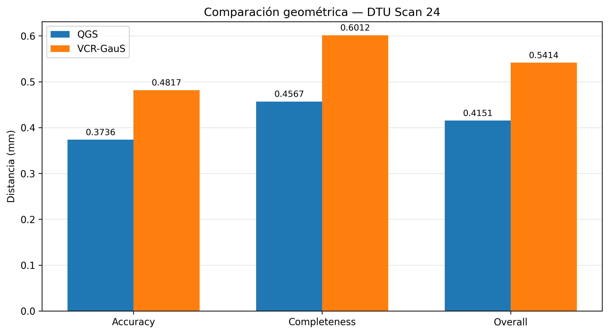

# Benchmark: QGS vs VCR-GauS en DTU

Este proyecto compara dos métodos de reconstrucción geométrica basados en Gaussian Splatting:

- **QGS (Quadratic Gaussian Splatting, ICCV 2025):** utiliza primitivas geométricas cuadráticas de segundo orden para representar superficies.
- **VCR-GauS (NeurIPS 2024):** utiliza Gaussianas 3D e incorpora un regularizador de profundidad y normales consistente entre múltiples vistas.

El objetivo es comparar la calidad geométrica de las superficies reconstruidas mediante métricas de distancia entre la reconstrucción y una geometría de referencia (*ground truth*).

Los experimentos se realizan sobre el conjunto de datos **DTU**, utilizando el escaneo 24 (`scan24`).

Además, se documentan las correcciones aplicadas a la implementación de VCR-GauS para conseguir un entrenamiento estable en el entorno utilizado.

## Resultados principales

### Evaluación geométrica: DTU scan24

Se evaluaron las dos reconstrucciones utilizando un procedimiento común de filtrado y los mismos parámetros de evaluación.

| Método | Accuracy (mm) | Completeness (mm) | Overall (mm) |
|---|---:|---:|---:|
| QGS | 0.37360 | 0.45668 | **0.41514** |
| VCR-GauS | 0.48166 | 0.60121 | **0.54143** |

QGS obtuvo un valor Overall aproximadamente **23.33 % menor** que VCR-GauS en el escaneo 24.

Estos resultados corresponden exclusivamente a `scan24` y no representan una evaluación sobre el conjunto completo DTU.

### Visualización de resultados

La siguiente figura presenta la comparación de las tres métricas geométricas:



Los resultados numéricos se encuentran en `results/metrics/comparison.csv`.

## Estructura del proyecto

```text
PFC1DanielaPerales/
├── QGS/                       Repositorio de QGS (submódulo)
├── VCR-GauS/                  Repositorio de VCR-GauS (submódulo)
├── configs/
│   ├── qgs/
│   │   └── dtu_scan24.yaml
│   └── vcr_gaus/
│       └── dtu_scan24.yaml
├── scripts/
│   ├── training/
│   │   ├── train_qgs.sh
│   │   └── train_vcr_gaus.sh
│   ├── evaluation/
│   │   ├── evaluate_common.py
│   │   └── evaluate_metrics.py
│   └── analysis/
│       ├── compare_metrics.py
│       └── visualize_results.py
├── environments/
│   ├── qgs/
│   │   ├── environment.yml
│   │   └── README.md
│   └── vcr_gaus/
│       ├── environment.yml
│       └── README.md
├── patches/
│   └── vcr_gaus/
│       └── vcr_gaus_fixes.patch
├── results/
│   ├── metrics/
│   │   └── comparison.csv
│   └── figures/
│       └── metrics_comparison_scan24.png
├── docs/
│   ├── methodology.md
│   ├── experimental_setup.md
│   └── references.md
├── datasets/                  Datos locales (no incluidos)
├── outputs/                   Entrenamientos (no incluidos)
├── .gitignore
├── .gitmodules
└── README.md
```

Los directorios `datasets/` y `outputs/` contienen archivos locales que no se incluyen en el repositorio. Las mallas PLY intermedias y los checkpoints tampoco forman parte de los resultados publicados.

## Requisitos

Los experimentos se realizaron en el siguiente entorno:

| Componente | QGS | VCR-GauS |
|---|---|---|
| Sistema operativo | Linux | Linux |
| Python | 3.9.19 | 3.10.22 |
| PyTorch | 2.2.2 | 2.0.1 |
| Torchvision | 0.17.2 | 0.15.2 |
| CUDA | 12.1 | 11.8 |
| GCC | 12 | 11 |

Hardware utilizado:

- GPU: NVIDIA GeForce RTX 4060 Laptop GPU.
- Memoria de GPU: 8 GB.
- Gestor de entornos: Conda.

Cada método requiere un entorno independiente debido a sus diferentes versiones de PyTorch y CUDA.

## Instalación

### 1. Clonar el repositorio

```bash
git clone --recurse-submodules https://github.com/danielaperalesestrada/PFC1DanielaPerales.git

cd PFC1DanielaPerales
```

La opción `--recurse-submodules` permite inicializar los repositorios de QGS y VCR-GauS.

### 2. Preparar QGS

Crear y activar el entorno:

```bash
conda env create -f environments/qgs/environment.yml
conda activate QGS
```

Después, seguir las instrucciones de instalación y compilación de:

[`environments/qgs/README.md`](environments/qgs/README.md)

### 3. Preparar VCR-GauS

Crear y activar el entorno:

```bash
conda env create -f environments/vcr_gaus/environment.yml
conda activate vcr
```

Después, seguir las instrucciones de instalación y compilación de:

[`environments/vcr_gaus/README.md`](environments/vcr_gaus/README.md)

## Conjunto de datos DTU

El experimento utiliza dos componentes del conjunto de datos DTU:

**Datos de entrenamiento**

El escaneo seleccionado debe estar disponible en:

```text
datasets/
└── dtu/
    └── DTU/
        └── scan24/
            ├── images/
            └── ...
```

**Datos de referencia**

Los archivos de referencia utilizados para la evaluación se encuentran organizados bajo:

```text
datasets/
└── dtu_gt/
    └── dtu-sample/
        └── SampleSet/
            └── MVS_Data/
                ├── ObsMask/
                ├── Points/
                ├── Calibration/
                ├── Rectified/
                └── ...
```

Para el escaneo 24 se utilizan, entre otros, los siguientes archivos:

- `Points/stl/stl024_total.ply`
- `ObsMask/ObsMask24_10.mat`
- `ObsMask/Plane24.mat`

La ubicación de los datos debe respetar las rutas indicadas en las configuraciones YAML y en los scripts de evaluación.

Los conjuntos de datos no se distribuyen con este repositorio. Deben obtenerse por separado siguiendo las indicaciones oficiales de DTU.

## Entrenamiento

Los scripts de entrenamiento utilizan las configuraciones portables almacenadas en `configs/`.

### QGS

Activar el entorno y ejecutar:

```bash
conda activate QGS

bash scripts/training/train_qgs.sh
```

El script utiliza `configs/qgs/dtu_scan24.yaml` y guarda los resultados en:

```text
outputs/qgs_scan24/
```

El directorio de salida debe estar vacío para iniciar el entrenamiento. El script evita sobrescribir resultados anteriores.

### VCR-GauS

Activar el entorno y ejecutar:

```bash
conda activate vcr

bash scripts/training/train_vcr_gaus.sh
```

El script utiliza `configs/vcr_gaus/dtu_scan24.yaml` y guarda los resultados en:

```text
outputs/vcr_gaus/dtu/scan24/final_shpy/
```

La configuración contempla 30 000 iteraciones, checkpoints cada 2 000 iteraciones y guardados del modelo en las iteraciones 14 000, 29 000 y 30 000.

El script registra el entrenamiento en `train.log` y utiliza una configuración de memoria CUDA compatible con PyTorch 2.0.1.

Para seleccionar otro directorio de salida se puede definir la variable `VCR_LOGDIR`:

```bash
VCR_LOGDIR=/ruta/alternativa bash scripts/training/train_vcr_gaus.sh
```

Este directorio también debe estar vacío antes de comenzar.

## Evaluación geométrica

La evaluación se organiza en dos etapas: filtrado común de las mallas y cálculo de métricas.

### 1. Filtrado con una máscara común

Una vez obtenidas las mallas de ambos métodos, ejecutar desde la raíz del proyecto:

```bash
python scripts/evaluation/evaluate_common.py --method both
```

El script permite procesar ambos métodos o seleccionar uno mediante `--method qgs` y `--method vcr_gaus`.

Las mallas filtradas se almacenan en:

```text
results/dtu/scan24/comparison/
├── qgs/
│   ├── culled_mesh_common.ply
│   └── culling_report.json
└── vcr_gaus/
    ├── culled_mesh_common.ply
    └── culling_report.json
```

Las rutas de las mallas originales se encuentran definidas en `scripts/evaluation/evaluate_common.py`.

### 2. Cálculo de métricas

Para evaluar ambas reconstrucciones utilizando el mismo protocolo:

```bash
python scripts/evaluation/evaluate_metrics.py \
    --method both \
    --density 0.2 \
    --patch 60 \
    --max-dist 20 \
    --seed 42 \
    --workers 4
```

El script también permite evaluar cada método individualmente.

Los informes detallados se almacenan junto a las mallas filtradas, en archivos `metrics_common.json`.

### 3. Comparación de resultados

Generar la tabla comparativa:

```bash
python scripts/analysis/compare_metrics.py
```

Este script comprueba que ambos métodos utilizaron los mismos parámetros de evaluación y verifica que Overall corresponda al promedio de Accuracy y Completeness.

El resultado se guarda en:

```text
results/metrics/comparison.csv
```

### 4. Generación del gráfico

Para generar la visualización comparativa:

```bash
python scripts/analysis/visualize_results.py
```

La figura se guarda en:

```text
results/figures/metrics_comparison_scan24.png
```

## Correcciones de VCR-GauS

Durante el trabajo con VCR-GauS se realizaron modificaciones sobre tres archivos de la implementación original:

| Archivo | Modificación |
|---|---|
| `python_scripts/run_base.py` | Ajustes de los argumentos incluidos en los comandos de entrenamiento. |
| `scene/dataset_readers.py` | Modificación de la lectura de la nube de puntos para utilizar los archivos disponibles. |
| `trainer.py` | Cambios en la inicialización y configuración de WandB. |

El parche con estas modificaciones se encuentra en:

[`patches/vcr_gaus/vcr_gaus_fixes.patch`](patches/vcr_gaus/vcr_gaus_fixes.patch)

Las modificaciones y su contexto técnico se documentan junto con el código del proyecto y los archivos de análisis.

## Documentación adicional

Para conocer con mayor detalle el proyecto, consultar:

- [Metodología](docs/methodology.md): descripción de los métodos y del procedimiento de comparación.
- [Configuración experimental](docs/experimental_setup.md): hardware, software, parámetros y métricas utilizadas.
- [Referencias bibliográficas](docs/references.md): publicaciones científicas y repositorios originales.
- [Entorno QGS](environments/qgs/README.md): instalación y compilación de QGS.
- [Entorno VCR-GauS](environments/vcr_gaus/README.md): instalación y compilación de VCR-GauS.

## Referencias

- Zhang et al. (2025). *Quadratic Gaussian Splatting: High Quality Surface Reconstruction with Second-order Geometric Primitives*. ICCV.
- Chen et al. (2024). *VCR-GauS: View Consistent Depth-Normal Regularizer for Gaussian Surface Reconstruction*. NeurIPS.
- Jensen et al. (2014). *Large Scale Multi-view Stereopsis Evaluation*. CVPR.

Las referencias bibliográficas completas se encuentran en [`docs/references.md`](docs/references.md).
